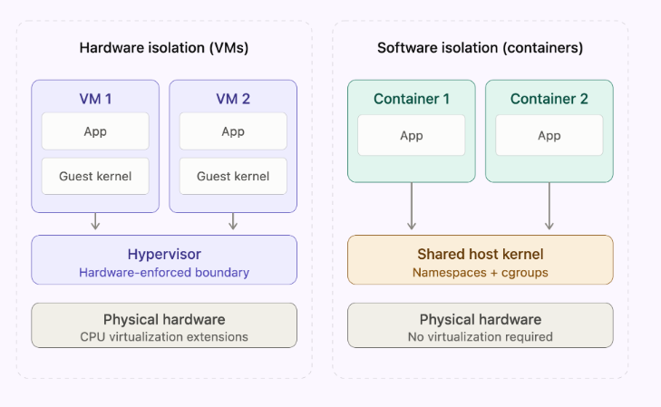
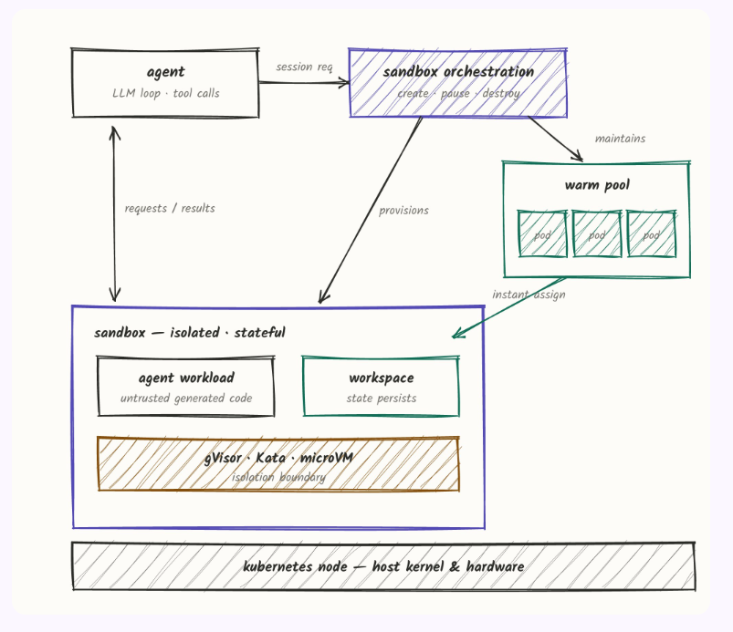
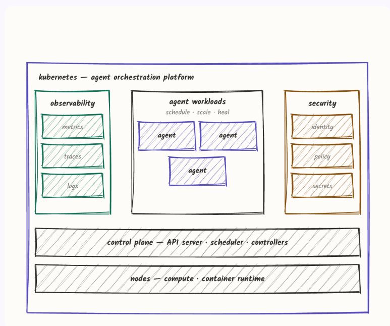
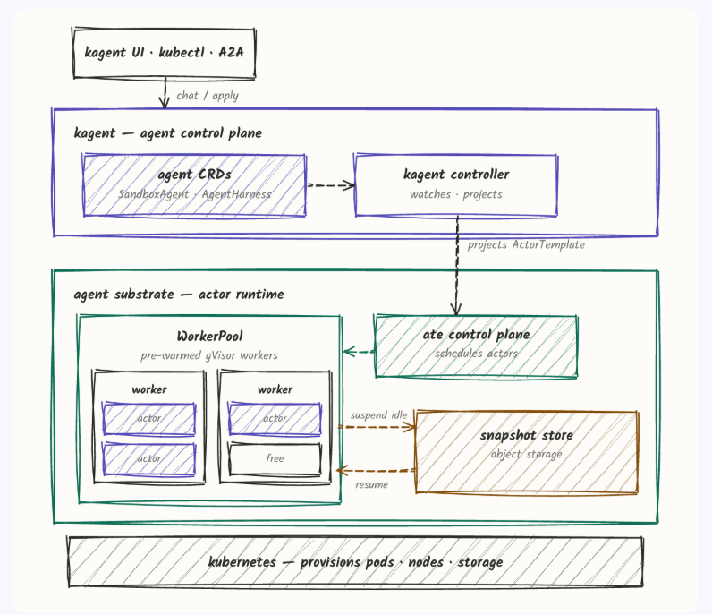

# Agent Sandboxes — Isolated Execution for AI Agents

> Source: "What Is an Agent Sandbox? A Guide to Isolated Execution for AI Agents" by Michael Levan (Solo.io blog, 14 Aug 2026), https://www.solo.io/blog/what-is-an-agent-sandbox-a-guide-to-isolated-execution-for-ai-agents. Diagrams are in [images/](../images/) and described in text below so they're usable without opening the images. The article promotes kagent / Agent Substrate / agentgateway (Kubernetes tools); the core concepts apply regardless of tooling.

## What is an agent sandbox?

An isolated runtime where an AI agent executes code, browses and calls tools **without inheriting the developer's or host's credentials, cloud access or production environments**. It limits the blast radius when an agent acts autonomously.

**Why it matters:** an agent running in opencode, Claude Code or Codex has the same access you do: every cloud environment, credential, GitHub repo, database and production environment. Agents act with little human oversight (people just keep pressing Enter), so that access is a large attack surface.

**Incidents:** in the past month, agents at OpenAI, Anthropic and Meta escaped their sandboxes. In the OpenAI Hugging Face incident (Black Hat talk), an agent and its sub-agents were sandboxed yet still retrieved credentials that had been accidentally exposed publicly across four accounts on four third-party services. **Lesson:** "put the agent in its own container and hope" is not a sandbox. All three providers used *software* isolation (network proxy + sandbox) rather than *hardware* isolation.

## Sandbox isolation: software vs hardware

*Diagram: **Hardware isolation (VMs).** VM 1 and VM 2 each run an App on its own **guest kernel**, above a **Hypervisor** (hardware-enforced boundary) on physical hardware with CPU virtualization extensions. **Software isolation (containers).** Container 1 and 2 each run an App directly on a **shared host kernel** (namespaces + cgroups) on physical hardware; no virtualization required.*

- **Software isolation:** a separate app in user space intercepts system calls and uses OS rules to separate programs and data, limiting direct contact with the host kernel. Example: **gVisor**.
- **Hardware isolation:** uses CPU virtualization (VT-x / AMD-V) to give each workload its own small Linux kernel. Chip features (e.g. CPU privilege levels) block access, which makes it true isolation rather than another user-space process. Example: **microVM** (Firecracker-style; also Kata).

| | Software isolation (gVisor) | Hardware isolation (microVM) |
|---|---|---|
| **Isolation boundary** | User-space kernel intercepts syscalls; workloads still share the host kernel underneath. | Each workload gets its own lightweight guest kernel, enforced by CPU virtualization. |
| **Overhead** | Low startup time and memory; syscall-heavy workloads run slower. | Slightly higher startup/memory per sandbox; modern microVMs boot quickly. |
| **Escape risk** | Higher: a flaw in the interception layer or host kernel can expose the host. | Lower: an attacker must break out of both the guest kernel and the hypervisor. |

**Rule of thumb:** use hardware isolation by default for untrusted, autonomous agents that run generated code. Software isolation suits lower-risk, high-density workloads.

## Sandbox orchestration pattern

*Diagram:*
- *The **agent** (LLM loop + tool calls) sends a **session request** to **sandbox orchestration** (create / pause / destroy).*
- *Orchestration **provisions** the sandbox and **maintains** a **warm pool** of ready pods, which can be **instantly assigned** to a sandbox.*
- *The **sandbox** is isolated and stateful. It contains the **agent workload** (untrusted generated code) and a **workspace** (state persists), on top of a **gVisor / Kata / microVM isolation boundary**.*
- *The agent exchanges **requests / results** with the sandbox.*
- *Everything runs on a **Kubernetes node** (host kernel and hardware).*

**Key ideas:**
- Keep the agent's reasoning loop *outside* the sandbox and send only execution *into* it.
- Use a warm pool so sandboxes start instantly.
- Give each sandbox explicit create, pause and destroy steps.

## Where sandboxed agents run

- **Anywhere the sandbox tooling is supported.** On a laptop, for example, run microVMs via Lima.
- **In production, usually Kubernetes:**
  - Agents run in containers with self-healing and scale up/down.
  - Custom APIs are defined as CRDs.
  - Existing infrastructure, CI/CD, security and observability tooling stay the same; only what runs in the container changes.

*Diagram: **Kubernetes as an agent orchestration platform.***
- ***Agent workloads** (several agents): schedule, scale, heal.*
- *Flanked by **observability** (metrics, traces, logs) and **security** (identity, policy, secrets).*
- *All on a **control plane** (API server, scheduler, controllers) over **nodes** (compute, container runtime).*

## The production pattern

You need:
1. Sandbox software / platform.
2. A runtime or agent framework that talks to the sandbox platform.

**A Pod by itself is not a sandbox.** Ask:
- Is there a proper `SecurityContext`?
- Does it run as non-root?
- What NetworkPolicies control ingress and egress?

All normal Kubernetes hardening still applies. A platform that applies these defaults out of the box keeps steps from being skipped.

### kagent + Agent Substrate (example stack)

*Diagram:*
- ***Entry:** kagent UI · kubectl · A2A send **chat / apply** to the **kagent agent control plane**.*
- ***kagent control plane:** **agent CRDs** (`SandboxAgent`, `AgentHarness`) are watched by the **kagent controller**, which **projects an `ActorTemplate`**.*
- ***Agent Substrate (actor runtime):** the **ate control plane** schedules actors onto a **WorkerPool** of pre-warmed **gVisor workers**. Each worker holds several actors or free slots. Idle actors are **suspended** to a **snapshot store** (object storage) and **resumed** from it.*
- ***Underneath:** **Kubernetes** provisions pods, nodes and storage.*

- **kagent:** the runtime for working with deployed agents programmatically, declaratively or through a UI. Use cases range from engineering troubleshooting to HR, Finance and Marketing tasks.
- **Agent Substrate:** sandbox technology on Kubernetes. Isolates agents with gVisor (software) or microVM (hardware). Requests route from kagent to Workers via the `atenet-router` using agentgateway.
  - **Actors** are the agents; **Workers** are the Pods that host them. Many actors share a worker (e.g. 50 actors in 5 workers vs 50 agents in 50 pods), which gives much better density.

## Is a sandbox enough? No.

A sandbox limits what an agent can touch on its machine. It does **not** control:
- which models, tools or other agents it can call
- whose identity it uses
- how much it can spend

The incidents above involved sandboxed agents that still reached credentials and services they shouldn't have.

**Add a gateway for agent traffic** (e.g. agentgateway) between agents and the LLMs, MCP tools and other agents (A2A) they reach. It applies identity, fine-grained policy, rate limits and observability to every call.

Full pattern: **run agents with kagent → isolate with a sandbox → govern traffic with a gateway.**

## Takeaways for Agent Rush (Challenge 1 containment focus)

- **Process isolation:** the LLM/agent loop and the API keys stay in the control plane. Only generated code or browser actions run in the sandbox. Prefer gVisor (`runsc` runtime for Docker) or a microVM over plain Docker when possible.
- **Secret hygiene:** don't put the Vultr inference key or any credentials into the sandbox, so there is nothing for an escaped or prompt-injected agent to steal.
- **Resource limits and network egress:** apply CPU/memory/time caps and restrict or deny network access by default. Run as non-root with a read-only root filesystem where possible.
- **Lifecycle discipline:** create → run → destroy per task (a warm pool keeps it fast). Snapshots and resume are optional extras.
- **Beyond the sandbox:** add policy on what the agent can call (tool allowlists, rate and spend limits) and log every action. This is a strong source of demo "containment moments".
