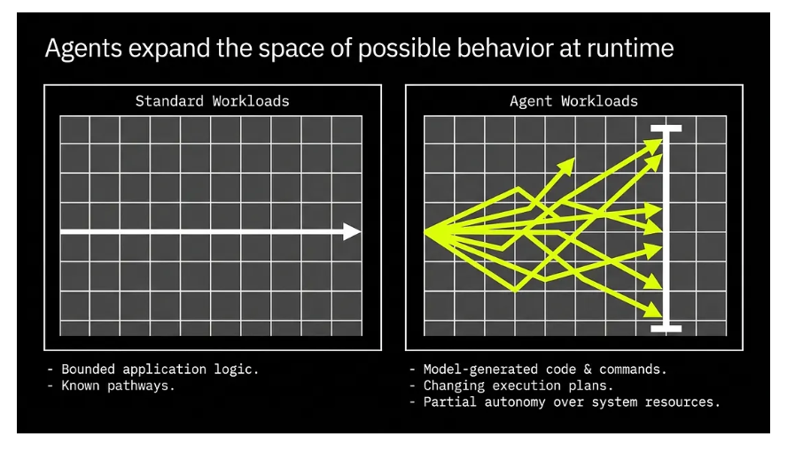
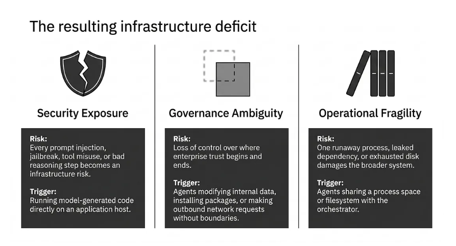
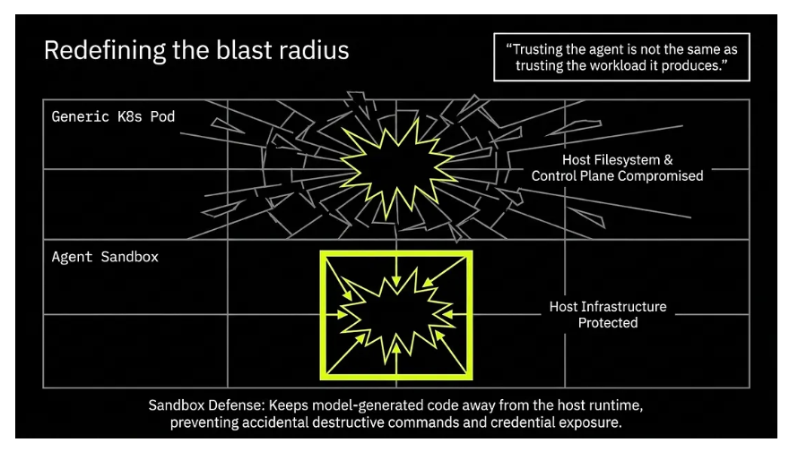
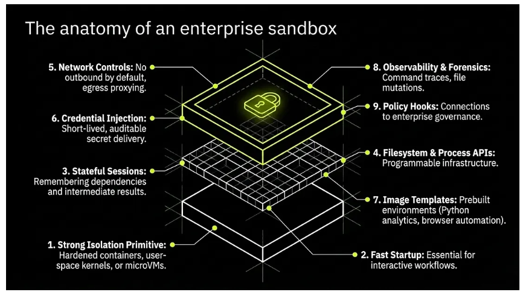
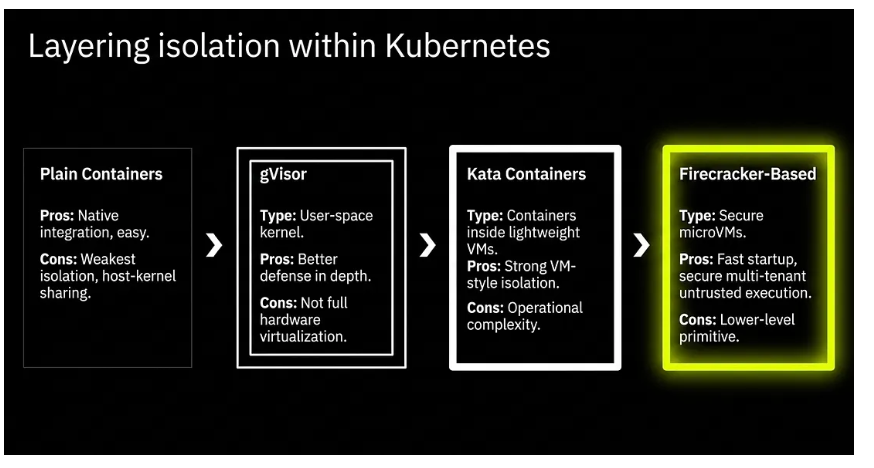
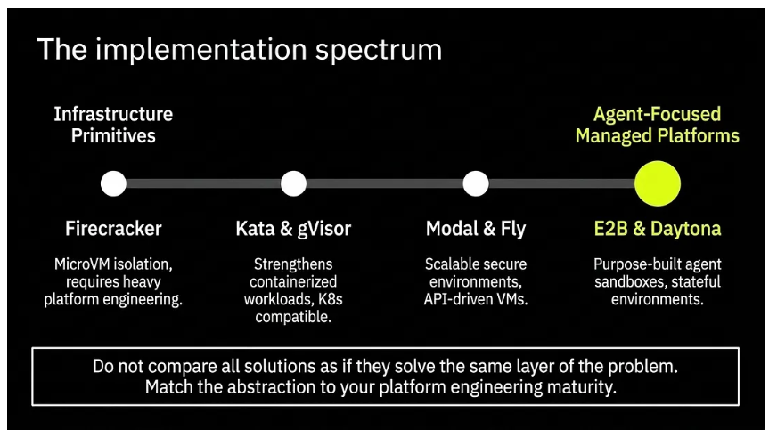
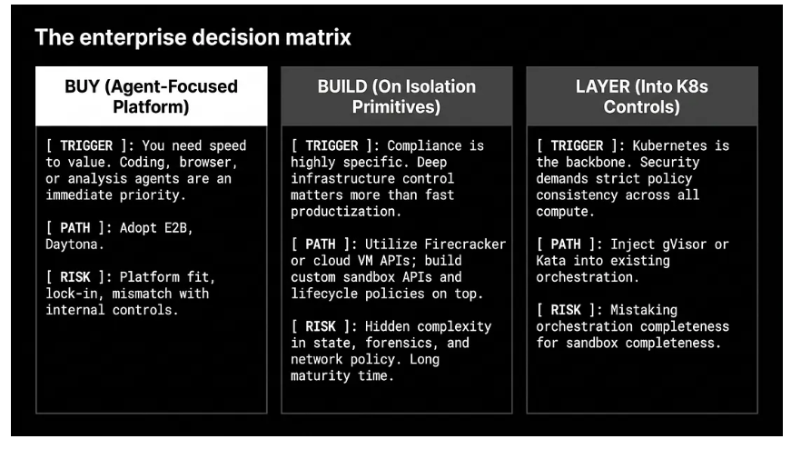
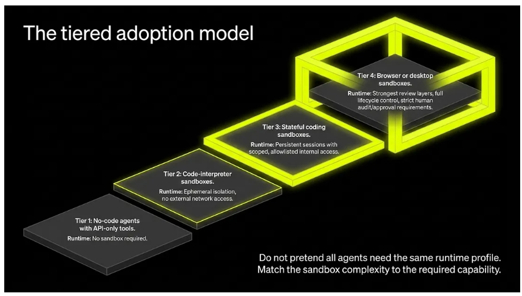

# Agent Sandboxes — The Runtime Layer for Enterprise AI Agents

> Source: "Agent Sandboxes: The Runtime Layer for Enterprise AI Agents" by Balaji Bal (Medium, 14 Aug 2026), https://medium.com/@balajibal/agent-sandboxes-the-runtime-layer-for-enterprise-ai-agents-88f207ac5e2e. Diagrams are in [images/](../images/) and described in text below. Complements [agent-sandbox.md](agent-sandbox.md).

**Core thesis:** an agent sandbox is not just a safe place to run code. It is a **runtime boundary for autonomous behaviour**. The hard question isn't "which model?" but "how do we give the agent enough capability to be useful without it becoming a security and governance liability?"

> **Containers package workloads. Kubernetes orchestrates workloads. Sandboxes govern risky workloads.**

## What an agent sandbox is

An isolated execution environment built for agent workloads. At minimum it gives the agent a bounded place to:
- execute code
- run processes and shell commands
- read and write files
- optionally access the network, a browser or a desktop
- hold short-lived state across steps
- return tool output to the orchestrating agent

It is defined by the **control model around execution**, not just the isolation mechanism underneath. An enterprise-grade sandbox combines:
- isolation from the host and from other tenants
- programmability (APIs / SDKs)
- lifecycle control (short-lived or long-running sessions)
- policy over network, credentials, filesystem and package installs
- observability of commands, files, outputs and failures
- reproducibility (images, snapshots, templates)
- agent-specific interaction patterns (iterative code execution, browser automation, inspection loops)

## Why agents need it

*Diagram: **"Agents expand the space of possible behavior at runtime."***
- ***Standard workloads:** a single straight arrow across a grid. Bounded application logic; known pathways.*
- ***Agent workloads:** many branching, zig-zagging arrows fanning out to many endpoints. Model-generated code and commands; changing execution plans; partial autonomy over system resources.*

Agent workloads involve:
- model-generated code and commands
- model-selected tools
- changing plans
- partial autonomy over files, APIs and resources
- action chains longer than a normal request/response

*Diagram: **"The resulting infrastructure deficit."** Three columns:*

| Problem | Risk | Trigger |
|---|---|---|
| **Security exposure** | Every prompt injection, jailbreak, tool misuse or bad reasoning step becomes an infrastructure risk. | Running model-generated code directly on an application host. |
| **Governance ambiguity** | Loss of control over where enterprise trust begins and ends. | Agents modifying internal data, installing packages or making outbound requests without boundaries. |
| **Operational fragility** | One runaway process, leaked dependency or full disk damages the broader system. | Agents sharing a process space or filesystem with the orchestrator. |

## Core benefits

*Diagram: **"Redefining the blast radius."** Quote: "Trusting the agent is not the same as trusting the workload it produces."*
- ***Generic K8s Pod:** an explosion shatters outward through the grid; the host filesystem and control plane are compromised.*
- ***Agent Sandbox:** the same explosion is held inside a box, with arrows pointing inward; host infrastructure is protected.*
- *Caption: the sandbox keeps model-generated code away from the host runtime, preventing accidental destructive commands and credential exposure.*

- **Isolation of untrusted execution.** Protects against:
  - destructive commands
  - malicious packages
  - prompt-injected shell or code actions
  - dependency conflicts
  - host credential exposure

  This applies even if you "trust your own prompts."
- **More capability without infrastructure risk.** Teams make agents too weak out of fear. Sandboxes safely allow Python/JS execution, package installs, browser automation, file transformation, git and notebook-style analysis.
- **Reproducibility.** Templates, snapshots and prebuilt images prevent environment drift ("worked yesterday because package X existed"), so behavior is testable and explainable.
- **Lifecycle control.** Choose per task: ephemeral, persistent across a session, resumable from a snapshot, or long-running in the background.
  - A coding agent may need hours.
  - A code-interpreter call needs seconds.
  - A browser flow may need a restorable state when a human steps in.
- **Observability.** Record what command ran, which files changed, which packages were installed, any network access, the artifacts produced, why a run failed, and whether it can be replayed.
- **Human intervention.** Inspect the environment, attach via SSH or a web terminal, review files and logs, resume from state, and approve the next step without rebuilding context.

## Key features (the anatomy)

*Diagram: an exploded, layered isometric stack (base box → grid layer → locked top layer) with nine labeled features, matching the list below.*

1. **Strong isolation primitive:** hardened containers, a user-space kernel (gVisor), lightweight VMs (Kata), microVMs (Firecracker), or managed environments built on these.
2. **Fast startup:** essential for interactive workflows; stronger isolation than a plain container without VM-level friction.
3. **Stateful sessions:** remember installed dependencies, downloads, cloned repos, intermediate results, and browser sessions/cookies.
   - Too little state means the agent keeps rebuilding context; too much makes it hard to govern. Choose deliberately.
4. **Filesystem and process APIs:** create, exec, stream output, upload/download files, inspect the filesystem, set env vars, snapshot/clone, destroy.
5. **Network controls:** no outbound access by default; allowlisted internal APIs; egress proxying and logging; DNS restrictions; data-residency boundaries; tenant-specific VPC routing.
6. **Credential injection:** short-lived, scoped, auditable delivery of secrets. Never copy permanent secrets in.
7. **Image templates:** prebuilt base environments for each agent type (Python analytics, browser automation, document transformation, coding with LSP and git).
8. **Observability and forensics:**
   - command traces
   - file changes
   - resource usage
   - network access
   - package installs
   - snapshots at failure time
   - links back to the user, agent, prompt or workflow run
9. **Policy and governance hooks:** which agent can launch which template, which network zones and data classifications it can reach, the maximum sandbox lifetime, and when human approval is required.

## Sandbox ≠ Docker container ≠ Kubernetes

- **A container packages software.** **A sandbox governs execution risk:** it adds runtime boundaries, lifecycle control, inspection, policy and often stronger isolation.
- Questions to ask anyone who says "we have Docker, so we have sandboxes":
  - How is model-generated code isolated from the host kernel?
  - How is network egress controlled for each run?
  - How are credentials injected and revoked?
  - How are file and command activity observed?
  - How is state restored or replayed?
  - How is one tenant's agent kept from affecting another?

  Vague answers mean you only have containerized execution.
- **Kubernetes** provides scheduling, service discovery, quotas, deployment and policy hooks. It does **not** provide:
  - strong isolation for untrusted code
  - agent session semantics
  - snapshots and resume
  - per-run forensics
  - browser/desktop or code-interpreter sessions

  So sandboxes are layered *inside* K8s; K8s is not the sandbox.

## Isolation patterns within Kubernetes

*Diagram: a left-to-right progression of four boxes with increasing isolation. Plain Containers → gVisor → Kata Containers → **Firecracker-Based** (highlighted).*

| Pattern | Type | Pros | Cons |
|---|---|---|---|
| **Plain containers** | Namespaces + cgroups | Easiest, native K8s, fast startup, familiar | Weakest isolation; shares the host kernel; poor fit for adversarial/prompt-injected code. OK only for low-risk internal tasks. |
| **gVisor** | User-space kernel | Stronger than plain containers; works with Docker/containerd/K8s; defense in depth; container-native ops | Not full hardware virtualization; some compatibility and performance gaps; you build the lifecycle features yourself |
| **Kata Containers** | Containers inside lightweight VMs | VM-style isolation; K8s/OCI compatible; better multi-tenant posture | More operational complexity; startup/performance tradeoffs; not a full agent sandbox product |
| **Firecracker** | Secure microVMs | Strong isolation; fast startup and small footprint; good for multi-tenant untrusted execution | Low-level primitive; needs significant platform engineering around it |

## Solution landscape

*Diagram: a spectrum from **infrastructure primitives** (left) to **agent-focused managed platforms** (right):*
- *Firecracker: microVM isolation; needs heavy platform engineering.*
- *Kata and gVisor: strengthen containerized workloads; K8s-compatible.*
- *Modal and Fly: scalable secure environments; API-driven VMs.*
- ***E2B and Daytona:** purpose-built agent sandboxes; stateful environments.*

*Footer: "Do not compare all solutions as if they solve the same layer of the problem. Match the abstraction to your platform engineering maturity."*

| Solution | What it is | Strengths | Weaknesses | Best when |
|---|---|---|---|---|
| **E2B** | Agent-first sandbox product; Firecracker-based; SDK-driven; self-host / BYO cloud options | Fits agent workflows out of the box; iterative code execution and analysis; fast startup; less platform work | Opinionated abstractions may not match enterprise controls | You want an opinionated agent sandbox quickly (code, analysis, computer use) |
| **Daytona** | Fast, stateful, long-running sandboxes; FS/process/git/LSP APIs; Linux/Windows/macOS desktops; open source; customer-managed compute | Great for coding agents; human-in-the-loop via SSH/editor; statefulness | Long-lived and desktop environments widen what must be governed | Agents need rich, stateful dev environments |
| **Modal Sandboxes** | Sandboxes as a primitive in a broader AI compute platform | Elastic autoscaling; integrates with inference/training/batch; mature ops | Less agent-opinionated; more infrastructure-centric | You're already standardizing on Modal |
| **gVisor** | Open-source container hardening (user-space kernel) | Defense in depth; K8s compatible; good for LLM-generated code | Not a runtime product; you build lifecycle, sessions, snapshots and UX | Platform teams hardening container execution |
| **Kata Containers** | Containers in lightweight VMs | Strong isolation; K8s fit; standards-aligned | Operationally heavier; no session/agent management | A K8s-centered approach where you'll build the runtime layer |
| **Firecracker** | MicroVM technology | High-quality isolation; fast; low overhead | Too low-level to use directly; needs a big control plane | A foundation for building or choosing a platform |
| **Fly Machines** | Fast-launching VMs via API | API-driven VM lifecycle; fast; location-aware | A VM primitive; you design credentials, policy and sessions | You want programmable VM isolation with geographic flexibility |

**Partial answers:**
- **Plain cloud VMs:** strong isolation, but slow and costly per task, with low density.
- **Hosted notebooks:** good for human-led analysis, weak for governed autonomous agents.
- **Browser automation platforms:** solve one capability; you usually need a second runtime for code and files.

## Build, buy, or layer?

*Diagram: three columns: BUY, BUILD, LAYER, each with a trigger, a path and a risk:*

| | **BUY** (agent-focused platform) | **BUILD** (on isolation primitives) | **LAYER** (into K8s controls) |
|---|---|---|---|
| **Trigger** | Need speed to value; coding/browser/analysis agents are an immediate priority | Highly specific compliance; deep infrastructure control matters more than fast delivery | K8s is the backbone; security needs consistent policy across all compute |
| **Path** | Adopt E2B or Daytona | Firecracker or cloud VM APIs, with custom sandbox APIs and lifecycle policies on top | Add gVisor or Kata to existing orchestration |
| **Risk** | Platform fit, lock-in, mismatch with internal controls | Hidden complexity in state, forensics and network policy; long time to maturity | Mistaking a complete orchestration setup for a complete sandbox |

## Tiered adoption model

*Diagram: four ascending isometric platforms, with Tier 4 enclosed in a glowing cage. Caption: "Do not pretend all agents need the same runtime profile. Match the sandbox complexity to the required capability."*

| Tier | Agent class | Runtime |
|---|---|---|
| **1** | No-code agents with API-only tools | No sandbox required |
| **2** | Code-interpreter sandboxes | Ephemeral isolation, **no external network access** |
| **3** | Stateful coding sandboxes | Persistent sessions with scoped, allowlisted internal access |
| **4** | Browser or desktop sandboxes | Strongest review layers, full lifecycle control, strict human audit/approval |

Start with narrow questions instead of "let the agent do anything safely":
- Which agent classes need code execution? Network access? A browser or desktop?
- Which data zones can each class reach?
- Which runs are ephemeral and which are stateful?
- Which actions need human approval?

## Takeaways for Agent Rush

- **Challenge 1 maps to the tiers:**
  - **Pattern A** (sandboxed code execution) is **Tier 2**: ephemeral, no network.
  - **Pattern B** (sandboxed browser) is **Tier 4**: human approval before final actions, which the brief already requires.
- A plain `docker run` is not enough for this article's definition. Add:
  - gVisor (`--runtime=runsc`)
  - `--network none` (or an egress allowlist proxy)
  - CPU/memory/pids/time limits
  - non-root and a read-only rootfs
  - a destroy step after each task
  - command and file-change logs
- **Strong demo material:** show the "blast radius" contrast. The same malicious or prompt-injected command runs in the sandbox, gets contained, and the host and secrets are shown untouched.
- **Matching the hackathon timeline:**
  - **Layer** gVisor onto Docker on a Vultr VM: a realistic choice in a week.
  - **Buy** E2B: faster, but less "on Vultr", which the judges weigh.
  - **Build** on Firecracker: likely too slow for a 5-day build.
