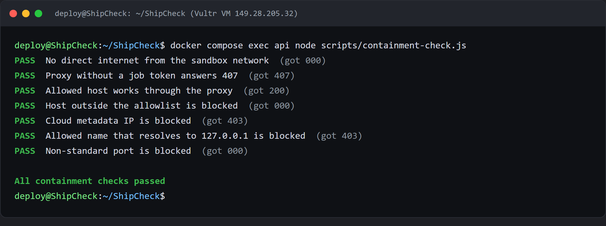
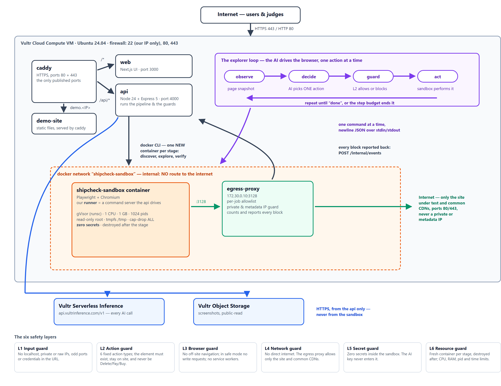

# ShipCheck

ShipCheck is a website auditor being built for the Vultr Agent Rush hackathon. It is designed to explore a public website like a visitor, check whether important user journeys work, and produce a report with evidence and practical fixes. The AI proposes a plan and one browser action at a time; ShipCheck code validates every proposed action before it can run.

## Project status

ShipCheck runs end to end: a POST to `/api/jobs` discovers the site in a fresh sandbox, plans, explores, measures, re-checks its own findings in a second clean sandbox and produces a report with a score, evidence and downloads. Real audits have been run locally — the record is in [docs/kan-17-first-local-run.md](docs/kan-17-first-local-run.md) — and on the production Vultr VM, where it is live at `https://app.149.28.205.32.sslip.io`.

On production, audits of the demo site complete with AI-planned journeys from `glm-5.3` on Vultr Serverless Inference, every sandbox runs under gVisor (`runsc`), screenshots are served from Vultr Object Storage, and `apps/api/scripts/containment-check.js` passes all seven network checks (see [Containment proof](#containment-proof)). One thing is still unproven: the demo site does not yet contain its planted exfiltration and write-request traps, so the network and safe-mode write blocks have not yet fired during a full audit.

Implemented AI building blocks:

- URL input policy and a strict Core browser-action guard.
- An OpenAI-compatible LLM client against Vultr Serverless Inference, with JSON parsing/validation and one corrective retry for invalid JSON. Live-tested with `glm-5.3`.
- Planner that selects only discovered page URLs, limits output, and falls back to simple page selection if AI is unavailable.
- Explorer loop that observes, asks for one action, validates it before use, records blocked actions, and enforces action and repetition limits.
- Analysis that adds AI explanations only to existing measured findings and keeps built-in guidance when AI fails.
- LLM smoke script for checking the provider's model list, both JSON modes, and a valid Core action.

## Demo and presentation

- 🎥 [System demo video](docs/demo/shipcheck-system-demo.mp4): a walkthrough of ShipCheck auditing a website end to end.
- 📊 [Presentation slides (PDF)](docs/demo/shipcheck-presentation.pdf): the hackathon pitch deck.

The live deployment is at `https://app.149.28.205.32.sslip.io`.

## How the agent is intended to work

```text
Website URL
   ↓
Input policy → discover same-site pages → AI plans journeys and pages
   ↓
Fresh isolated browser sandbox
   ↕  observe snapshot → AI proposes one action → action guard → browser acts
   ↓
Deterministic checks → AI explains findings → clean-sandbox verification → report
```

The AI never receives a free-form command to execute. Core actions are `goto`, `click`, `type`, and `done`. Each action is checked against a strict schema, the current page snapshot, URL scope, typeable-element flags, and risky click text before the sandbox receives it. The explorer is limited to 12 actions per journey and 40 per audit by default, and stops a repeated action loop. Website text is treated as untrusted input in planning, exploration, and analysis prompts.

## Blast Radius Zero: six safety layers

The complete design uses six layers. This table distinguishes the code currently in this checkout from pieces that still need implementation and integration.

| Layer | Protection | Current state |
|---|---|---|
| L1: Input validation | Accept only supported public HTTP(S) targets; reject unsafe hosts, schemes, credentials, and out-of-scope URLs. | Implemented in `apps/api/src/security/policy.js`; unit tests cover the policy. |
| L2: Action restrictions | Validate each AI action, element reference, typeable flag, URL scope, and dangerous click; cap actions and repeated loops. | Guard and explorer limits are implemented in `apps/api/src/security/actionGuard.js` and `apps/api/src/agent/explorer.js`. The guard holds all six action shapes from the contract; the Core explorer only ever proposes four, and `select`/`login` stay stretch work. |
| L3: Browser protection | Abort off-site navigation and unsafe writes; dismiss dialogs and disable service workers. | Implemented in `sandbox/runner.js`, including per-request URL-scope checks and redirect checks. |
| L4: Network restrictions | Put the sandbox on an internal-only Docker network and require its traffic to pass through a per-job allowlist egress proxy. | The egress proxy is in `apps/egress-proxy` with a per-job allowlist, and the driver refuses to start on a Docker network that is not internal. Isolation on the production network is proven by `apps/api/scripts/containment-check.js`, which passes all seven checks on the VM. |
| L5: Secret protection | Keep inference and storage credentials in the API; do not pass API secrets, mounts, or the Docker socket into a sandbox. | The API driver launches without environment injection, mounts, or a Docker socket and stops if the runner reports secret-like environment variables. The runner counts its own secret-like variables and every report carries that count. |
| L6: Resource limits | Run each stage in a disposable gVisor sandbox with CPU, memory, process, time, and filesystem limits. | The API driver applies the Docker resource limits and uses `runsc` when `SANDBOX_RUNTIME=runsc`. On the production VM every sandbox runs under `runsc` with 1 CPU, 1 GB memory, a 1024-process limit, a read-only root and all capabilities dropped; the runtime in use is reported with every audit. |

### Containment proof

On the production VM, `docker compose exec api node scripts/containment-check.js` starts a throwaway container on the sandbox network and tries to get out:



The production security checklist (Document 3, step 9.2) also holds: only Caddy publishes ports (80 and 443), the Vultr Firewall limits SSH to the admin IP, `/internal/events` is not reachable from outside (404), a sandbox started by a demo audit carries no secrets (`Secrets inside sandbox: 0`) and runs under `runsc`, the job rate limit answers `429` after five requests an hour, and the VM's `.env` is `chmod 600`. Unit tests for the AI agent do not by themselves prove sandbox containment; these checks on the VM do.

## Architecture

This is the intended Core topology from Document 2. The six-layer table above distinguishes planned protections from code that is present in this checkout.



Every box in the diagram exists in this checkout and runs on the production Vultr VM: Caddy, web, api and egress proxy under Docker Compose, gVisor as the sandbox runtime, and Object Storage for screenshots.

## AI providers

The API uses one OpenAI-compatible client for planning, exploration, and analysis. Vultr Serverless Inference is the provider, locally as well as in deployment, so that what is demonstrated runs on the path that was tested. Provider, API key, base URL, and model come from `LLM_PROVIDER`, `LLM_API_KEY`, `LLM_BASE_URL`, and `LLM_MODEL`; both environment examples select Vultr with `glm-5.3`, and the settings and the reasoning are recorded in [docs/kan-21-ai-model.md](docs/kan-21-ai-model.md).

Another OpenAI-compatible endpoint can be selected locally with `LLM_PROVIDER` and `LLM_BASE_URL` for debugging without spending inference credits. The JSON schema validation and the one corrective retry stay in place whichever endpoint is used.

Use a Vultr inference key with a model your account can see. The smoke test lists the available models, checks that the configured ID is one of them, and verifies both JSON modes plus a valid Core action. Never put a provider key in source code or logs.

## Vultr services in the architecture

| Vultr service | Intended use | Current implementation state |
|---|---|---|
| Cloud Compute | Host the web app, API, egress proxy, and isolated browser containers. | Deployed: one Ubuntu VM runs Caddy, web, api and the egress proxy with `docker compose`, and starts a fresh gVisor sandbox per audit stage. |
| Serverless Inference | Planning, action selection, analysis, and summaries through the OpenAI-compatible client. | Both environment examples select Vultr with `glm-5.3`; model listing and the live smoke checks passed against a Vultr key. |
| Object Storage | Store screenshots and report artifacts. | Implemented behind one `putScreenshot`; `STORAGE_DRIVER=s3` selects it and `local` writes to disk for development. Production uses `s3`: audit screenshots are served from Vultr Object Storage. |
| Firewall | Restrict inbound access to administration and public web ports. | Configured: SSH (22) only from the admin IP; 80 and 443 open for Caddy. |

The deployment uses a Vultr Firewall to restrict inbound access to administration and the public web ports. Safe mode does not submit forms. A human approval step is not needed for Core because there is no final write action to approve.

## Local development

The project documentation targets Node.js 24 LTS. Install dependencies for the API:

```powershell
Set-Location apps/api
npm ci
```

Run the unit tests (these use mocked model responses and need no API key):

```powershell
npm test
```

To run the live Vultr model smoke test, copy `apps/api/.env.development.example` to `apps/api/.env.development` and enter your own Vultr inference key. Keep the key in that ignored file; do not commit it or paste it into chat. The provider, base URL and model are already filled in, so the smoke test can be run as it is:

```powershell
node --env-file=.env.development scripts/llm-smoke.js
```

The smoke test checks model listing, that `LLM_MODEL` is one of the models your account can see, JSON output with `LLM_JSON_MODE=true` and `false`, and a valid Core browser action. It must pass with the actual provider key and model before claiming live inference works. No credential is stored in this repository. Pass a model ID as an argument to try a candidate without editing the env file, and see [docs/kan-21-ai-model.md](docs/kan-21-ai-model.md) if `glm-5.3` is not on your key.

## Project documents

- [Agent definition](planning/01-agent-definition.en.md)
- [Architecture (Document 2)](planning/02-architecture.en.md)
- [Build steps (Document 3)](planning/03-build-steps.en.md)
- [Shared API and event contract](docs/CONTRACT.md)
- [System demo video](docs/demo/shipcheck-system-demo.mp4)
- [Presentation slides](docs/demo/shipcheck-presentation.pdf)

The build steps define Core versus stretch scope and are the implementation source of truth. The shared contract describes the complete v2 shapes; features marked stretch are not part of Core.