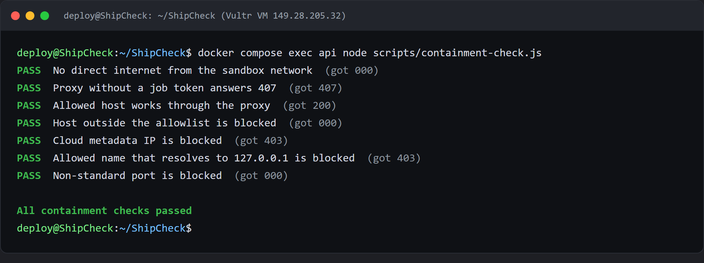

# How to produce the slides PDF

Two ways. **Option A takes about two minutes and needs no account.** Option B is here in
case you would rather have an editable deck.

The slide content is already written and checked — every number in it comes from a real
audit. Whichever way you go, do not reword it.

| File | What it is |
|---|---|
| `docs/slides.html` | The finished deck. Open it, print it, done. |
| `docs/slides.md` | The same content as plain text, for pasting into a slide tool. |

---

## Option A (recommended) — the HTML deck

`docs/slides.html` is a complete 8-slide deck. It is one file, it needs no internet, and
it prints to a PDF at the standard widescreen size.

The architecture diagram is stored inside the file itself, so you can email it, drop it in
a Teams chat or put it on OneDrive and it still renders. Nothing has to travel with it.

1. Open the repo folder on your computer and **double-click `docs/slides.html`**.
   It opens in your browser. Scroll down — you should see 8 dark slides.
2. Press **Ctrl + P** (Cmd + P on a Mac).
3. In the print dialog set:
   - **Destination / Printer:** `Save as PDF`
   - **Layout:** `Landscape`
   - **Margins:** `None`
   - **Scale:** `Default` (100%)
   - **Background graphics:** ✅ **ticked** — without this the slides print white
4. Click **Save** and name it `shipcheck-slides.pdf`.

✅ **Check:** the PDF has **8 pages**, each one a full dark slide with nothing cut off.

### Chrome gives the best result

Chrome and Edge both work. If you use Firefox and the slides look wrong, open it in
Chrome instead — the print sizing is more reliable there.

### If a slide looks too full

Open `docs/slides.html` in any text editor, find this line near the top:

```css
  p  { font-size: 23px; line-height: 1.5; margin: 0 0 16px; color: var(--ink); }
```

Change `23px` to `21px`, save, refresh the browser and print again. The same trick works
for `li { font-size: 23px ... }` just below it.

### Before you export

One thing is deliberately missing: the **video link** on slide 8. It currently reads
*"video: add the YouTube link"*. Once the video is uploaded, open `docs/slides.html`,
search for that line, replace it with the real link, then print.

**So export the PDF last, after the video is up.**

---

## Option B — Gamma

Only if you want a deck you can keep editing. It needs a free account at
<https://gamma.app>, and it has three traps we already hit:

1. **Sign in**, then **+ Create** → **Paste in text**.
2. Open `docs/slides.md`, select everything from the line `# ShipCheck` to the end, and
   paste it in. *(Do not paste the few lines of instructions above that heading.)*
3. Choose **Presentation**, then continue. You should see **Outline · 8 slides**.
4. **Trap 1 — the Preserve toggle.** At the bottom you will see **Preserve** and
   **Refine**. Make sure **Preserve** is selected. Its tooltip says *"Your exact outline
   text will be used"*. If Refine is on, Gamma rewrites the text and changes our numbers.
5. **Trap 2 — the deck style.** Do **not** pick **Visual**: its own description says
   *"title and images only, no body text"*, which deletes the whole containment table.
   Pick **Minimal**, or the style that keeps body text.
6. Pick a dark theme and press **Generate**.
7. **Trap 3 — overflow.** Gamma may warn that *"N slides have overflowing content"*.
   Click **Go to slides** and shorten those slides until the warning is gone, otherwise
   content is cut off in the export.
8. **Share** → **Export to PDF**. Do not export to PowerPoint or Google Slides — Gamma
   itself warns that the layout shifts.

After generating, read the slides once and confirm these numbers survived:

| Slide | Must say |
|---|---|
| Blast radius | `runsc`, **0** secrets, **214** off-site requests blocked |
| Architecture | model `glm-5.3`, four Vultr services |
| Results | 34 findings, 2 of 5 journeys failed, 26 findings on getbootstrap.com |

---

## Optional: add screenshots

The deck stands on its own, but two images make it stronger if you have a few minutes:

- **Slide 5 (Blast radius):** `docs/containment-check.png` — the containment check output.
- **Slide 4 (Results):** a screenshot of the demo-site report showing the red BLOCKED
  lines, from
  <https://app.149.28.205.32.sslip.io/jobs/0e1bb009-b818-47db-9131-54e3d8806e17>

In the HTML deck you add one like this, just before the `<div class="stats">` line of that
slide:

```html

```

The image must sit in the same `docs/` folder as `slides.html`.

---

## What "done" looks like

- `shipcheck-slides.pdf` — 8 pages, dark, nothing cut off
- The video link is on slide 8
- The numbers above are intact
